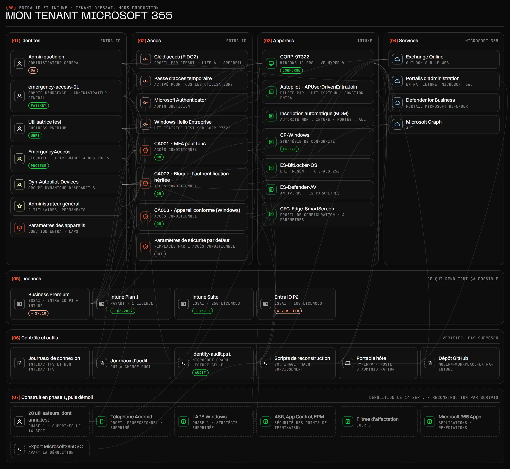

[Version française](fr/ARCHITECTURE.md)

# Architecture

The tenant in one diagram, walked through in eight steps. I present it live, in French, as an interactive page;
this is the same diagram as an image, then the same eight steps with their screenshots. Every name on this page
is the name in the diagram, and the screenshots are numbered in the order of the tour.

*Utilisatrice test* in the diagram is `lea.test` in the rest of this repo.

## The tour, step by step

| Step | In the diagram | Screenshots | Pages |
|---|---|---|---|
| 1 · The tenant (*Le tenant*) | Business Premium Intune Plan 1 Intune Suite Entra ID P2 | Live: Microsoft 365 admin center › Billing › Licenses | [What the lab covers](README.md#what-the-lab-covers) |
| 2 · Identities (*Les identités*) | Admin quotidien emergency-access-01 Utilisatrice test EmergencyAccess Dyn-Autopilot-Devices Administrateur général | Live: Entra › Users, Groups, Roles and administrators | [Identity](identity/README.md) |
| 3 · Never lose access (*Ne jamais perdre l'accès*) | emergency-access-01 EmergencyAccess Clé d'accès (FIDO2) Passe d'accès temporaire Admin quotidien Microsoft Authenticator | [01](screenshots/01-emergency-access-tap-sign-in.png) [02](screenshots/02-emergency-access-passkey-only.png) [03](screenshots/03-emergency-access-passkey-aaguid.png) | [Emergency account](identity/README.md#1-an-emergency-access-account-before-any-policy), [passkey](identity/README.md#2-a-passkey-on-an-account-with-no-methods) |
| 4 · Access rules (*Les règles d'accès*) | CA001 · MFA pour tous CA002 · Bloquer l'authentification héritée CA003 · Appareil conforme (Windows) Paramètres de sécurité par défaut EmergencyAccess | [04](screenshots/04-access-rules-no-policies-after-teardown.png) [05](screenshots/05-access-rules-security-defaults-off.png) [06](screenshots/06-access-rules-lockout-warning.png) [07](screenshots/07-access-rules-whatif-test-user.png) [08](screenshots/08-access-rules-whatif-emergencyaccess-excluded.png) [09](screenshots/09-access-rules-report-only-sign-in.png) [10](screenshots/10-access-rules-ca001-ca002-ca003-on.png) | [Conditional Access](identity/README.md#4-conditional-access) |
| 5 · The workstation (*Le poste de travail*) | CORP-97322 Autopilot · APUserDrivenEntraJoin Inscription automatique (MDM) Dyn-Autopilot-Devices CP-Windows ES-BitLocker-OS ES-Defender-AV CFG-Edge-SmartScreen Paramètres des appareils | [11](screenshots/11-workstation-mdm-authority-none.png) [12](screenshots/12-workstation-dyn-autopilot-devices.png) [13](screenshots/13-workstation-autopilot-apuserdrivenentrajoin.png) [14](screenshots/14-workstation-corp-97322-encrypted.png) [15](screenshots/15-workstation-cp-windows-compliant.png) [16](screenshots/16-workstation-cfg-edge-smartscreen.png) | [Autopilot chain](rebuild/README.md#the-autopilot-chain), [compliance](rebuild/README.md#compliance) |
| 6 · Check, don't assume (*Vérifier, pas supposer*) | Journaux de connexion Journaux d'audit identity-audit.ps1 Microsoft Graph | [17](screenshots/17-checks-audit-exclusion-was-the-user.png) [18](screenshots/18-checks-audit-exclusion-fixed.png) [19](screenshots/19-checks-audit-emergency-sign-ins.png) [20](screenshots/20-checks-audit-test-user-sign-ins.png) [21](screenshots/21-checks-bitlocker-portal-access-denied.png) [22](screenshots/22-checks-bitlocker-graph-403.png) [23](screenshots/23-checks-bitlocker-graph-200-ok.png) [24](screenshots/24-checks-bitlocker-three-recovery-keys.png) [25](screenshots/25-checks-defender-pua-protection-off.png) | [Checking it with PowerShell](identity/README.md#5-checking-it-with-powershell), [lab log](LAB-LOG.md) |
| 7 · Tear down and rebuild (*Démolir et reconstruire*) | 20 utilisateurs, dont anna.test Téléphone Android LAPS Windows ASR, App Control, EPM Filtres d'affectation Microsoft 365 Apps Export Microsoft365DSC Scripts de reconstruction Dépôt GitHub | [26](screenshots/26-first-round-update-pin-24h2-deploys-25h2.png) [27](screenshots/27-first-round-firewall-merge-conflict.png) [28](screenshots/28-first-round-ca-whatif-report-only.png) [29](screenshots/29-first-round-7zip-installed.png) [30](screenshots/30-first-round-app-protection-on-devices.png) | [Teardown](teardown/README.md), [rebuild](rebuild/README.md) |
| 8 · What I would do next (*Ce que je ferais ensuite*) | Every open point, shown with the Open points button | Live: the open points | [Still to do](identity/README.md#still-to-do) |

The October 2025 pipeline sits outside the diagram: [31](screenshots/31-pipeline-2025-secret-login.png) [32](screenshots/32-pipeline-2025-secret-readable.png), told in
[identity/workload-identity-2025.md](identity/workload-identity-2025.md).

## Every element with a screenshot

| Zone | Name in the diagram | What it is | Screenshots |
|---|---|---|
| (01) Identités | emergency-access-01 | emergency account | [01](screenshots/01-emergency-access-tap-sign-in.png) [02](screenshots/02-emergency-access-passkey-only.png) [03](screenshots/03-emergency-access-passkey-aaguid.png) [08](screenshots/08-access-rules-whatif-emergencyaccess-excluded.png) [19](screenshots/19-checks-audit-emergency-sign-ins.png) |
| (01) Identités | Utilisatrice test | test user | [07](screenshots/07-access-rules-whatif-test-user.png) [09](screenshots/09-access-rules-report-only-sign-in.png) [20](screenshots/20-checks-audit-test-user-sign-ins.png) |
| (01) Identités | EmergencyAccess | group that carries the exclusion | [08](screenshots/08-access-rules-whatif-emergencyaccess-excluded.png) [17](screenshots/17-checks-audit-exclusion-was-the-user.png) [18](screenshots/18-checks-audit-exclusion-fixed.png) |
| (01) Identités | Dyn-Autopilot-Devices | dynamic device group | [12](screenshots/12-workstation-dyn-autopilot-devices.png) |
| (02) Accès | Clé d'accès (FIDO2) | passkey (FIDO2) | [02](screenshots/02-emergency-access-passkey-only.png) [03](screenshots/03-emergency-access-passkey-aaguid.png) |
| (02) Accès | Passe d'accès temporaire | Temporary Access Pass | [01](screenshots/01-emergency-access-tap-sign-in.png) |
| (02) Accès | Windows Hello Entreprise | Windows Hello for Business | [20](screenshots/20-checks-audit-test-user-sign-ins.png) |
| (02) Accès | CA001 · MFA pour tous | CA001-Require-MFA-All-Users | [04](screenshots/04-access-rules-no-policies-after-teardown.png) [06](screenshots/06-access-rules-lockout-warning.png) [07](screenshots/07-access-rules-whatif-test-user.png) [09](screenshots/09-access-rules-report-only-sign-in.png) [10](screenshots/10-access-rules-ca001-ca002-ca003-on.png) [17](screenshots/17-checks-audit-exclusion-was-the-user.png) [18](screenshots/18-checks-audit-exclusion-fixed.png) |
| (02) Accès | CA002 · Bloquer l'authentification héritée | CA002-Block-Legacy-Authentication | [04](screenshots/04-access-rules-no-policies-after-teardown.png) [09](screenshots/09-access-rules-report-only-sign-in.png) [10](screenshots/10-access-rules-ca001-ca002-ca003-on.png) [17](screenshots/17-checks-audit-exclusion-was-the-user.png) [18](screenshots/18-checks-audit-exclusion-fixed.png) |
| (02) Accès | CA003 · Appareil conforme (Windows) | CA003-Require-Compliant-Device-Windows | [04](screenshots/04-access-rules-no-policies-after-teardown.png) [07](screenshots/07-access-rules-whatif-test-user.png) [09](screenshots/09-access-rules-report-only-sign-in.png) [10](screenshots/10-access-rules-ca001-ca002-ca003-on.png) [17](screenshots/17-checks-audit-exclusion-was-the-user.png) [18](screenshots/18-checks-audit-exclusion-fixed.png) [28](screenshots/28-first-round-ca-whatif-report-only.png) |
| (02) Accès | Paramètres de sécurité par défaut | security defaults | [05](screenshots/05-access-rules-security-defaults-off.png) |
| (03) Appareils | CORP-97322 | the managed VM | [14](screenshots/14-workstation-corp-97322-encrypted.png) [15](screenshots/15-workstation-cp-windows-compliant.png) [16](screenshots/16-workstation-cfg-edge-smartscreen.png) |
| (03) Appareils | Autopilot · APUserDrivenEntraJoin | Autopilot profile | [13](screenshots/13-workstation-autopilot-apuserdrivenentrajoin.png) |
| (03) Appareils | Inscription automatique (MDM) | automatic enrolment, MDM authority | [11](screenshots/11-workstation-mdm-authority-none.png) |
| (03) Appareils | CP-Windows | compliance policy | [15](screenshots/15-workstation-cp-windows-compliant.png) |
| (03) Appareils | ES-BitLocker-OS | BitLocker policy | [14](screenshots/14-workstation-corp-97322-encrypted.png) [21](screenshots/21-checks-bitlocker-portal-access-denied.png) [22](screenshots/22-checks-bitlocker-graph-403.png) [23](screenshots/23-checks-bitlocker-graph-200-ok.png) [24](screenshots/24-checks-bitlocker-three-recovery-keys.png) |
| (03) Appareils | ES-Defender-AV | Defender Antivirus policy | [25](screenshots/25-checks-defender-pua-protection-off.png) |
| (03) Appareils | CFG-Edge-SmartScreen | Edge SmartScreen profile | [16](screenshots/16-workstation-cfg-edge-smartscreen.png) |
| (04) Services | Microsoft Graph | Microsoft Graph | [22](screenshots/22-checks-bitlocker-graph-403.png) [23](screenshots/23-checks-bitlocker-graph-200-ok.png) |
| (06) Contrôle et outils | Journaux de connexion | sign-in logs | [09](screenshots/09-access-rules-report-only-sign-in.png) [19](screenshots/19-checks-audit-emergency-sign-ins.png) [20](screenshots/20-checks-audit-test-user-sign-ins.png) |
| (06) Contrôle et outils | identity-audit.ps1 | identity audit script | [17](screenshots/17-checks-audit-exclusion-was-the-user.png) [18](screenshots/18-checks-audit-exclusion-fixed.png) [19](screenshots/19-checks-audit-emergency-sign-ins.png) [20](screenshots/20-checks-audit-test-user-sign-ins.png) |
| (07) Construit en phase 1, puis démoli | Microsoft 365 Apps | apps, first round | [29](screenshots/29-first-round-7zip-installed.png) [30](screenshots/30-first-round-app-protection-on-devices.png) |

All 32 screenshots are described in [screenshots/README.md](screenshots/README.md), under the same step titles.
