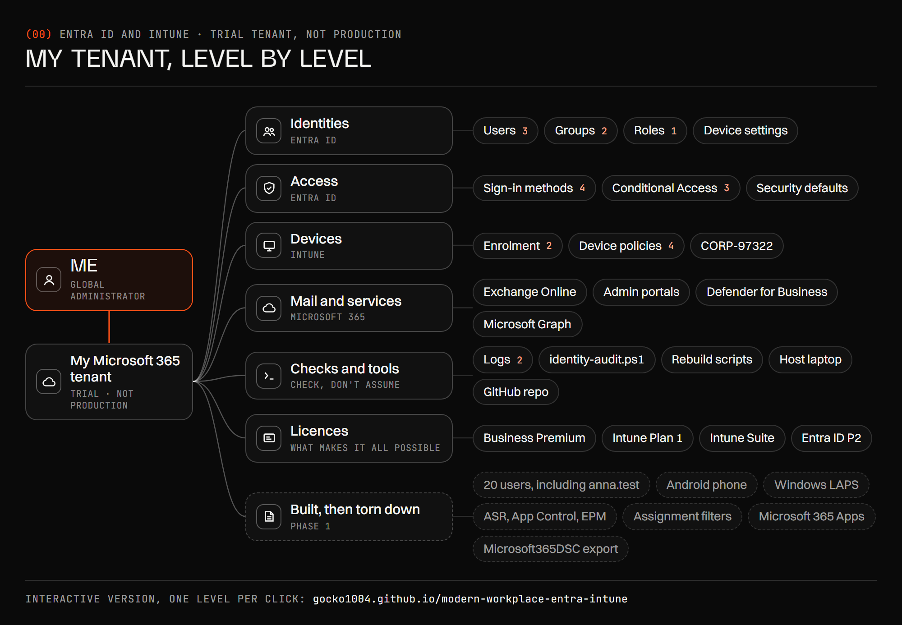

[Version française](fr/README.md)

# Modern Workplace with Microsoft Entra ID and Intune

**Goce Petrov** · Switzerland · Microsoft MD-102 (Endpoint Administrator) in preparation, hands-on in my own Microsoft 365 tenant

> **En bref.** Environnement Microsoft Entra ID et Intune, monté et dépanné par moi dans mon propre
> locataire Microsoft 365 depuis août 2026. Chaque panne est documentée : le message d’erreur exact,
> ce que j’ai vérifié, la cause, la correction. Les pages sont en anglais, la langue des consoles
> Microsoft. Version française complète : [fr/README.md](fr/README.md).

My own environment, not production: one Microsoft 365 trial tenant, Windows 11 virtual machines in
Hyper-V and, before the rebuild, one Android phone. Built from nothing on 17 August 2026, taken through all five MD-102
domains by 14 September, then torn down with scripts and rebuilt from scratch from 15 September.
In October, an identity part: an emergency access account with a passkey, and Conditional Access
built in report-only, tested, then switched on.

**The tenant level by level.** [The interactive diagram](https://gocko1004.github.io/modern-workplace-entra-intune/?lang=en)
opens one level per click, says why each part is built the way it is and shows the screenshots that prove it.
The same screenshots, in presentation order, are in [ARCHITECTURE.md](ARCHITECTURE.md).

A multiple-choice exam cannot show what this repo shows: the failures, the exact error text, what I
checked, and what it turned out to be.

---

## Start here: five incidents

| What broke | What it turned out to be | Read |
|---|---|---|
| Intune refused to enrol a device: *"This user is not authorized to enroll"* (80180003). | Ruled out network, licences, enrolment restrictions, device limits, stale objects and more, one at a time, with evidence. The tenant's MDM authority had never been set, and no menu in the portal leads to that setting. | [Day 3, Part 4](day-guides/day-03-windows-install-entra-join-and-intune-enrolment.md#part-4-error-80180003-and-a-full-day-to-find-a-one-click-cause) |
| A Windows LAPS policy reported success, but no password ever appeared. | Event 10059 in the device's own LAPS log: LAPS has to be switched on for the whole tenant in Entra ID, a setting neither the policy nor the LAPS page mentions. | [Lab log, Day 9](LAB-LOG.md#day-9-windows-laps-returned-0x80070190-and-the-portal-said-nothing-useful) |
| A Defender Antivirus policy reported "applied". | It was applied, and it was switching protection against potentially unwanted apps **off**. Proved the policy reached the device first, then read what it contained. | [Lab log, Day 13](LAB-LOG.md#day-13-the-antivirus-policy-was-enforcing-an-insecure-value) |
| The portal refused to show a BitLocker recovery key to a Global Administrator. | Microsoft Graph returned the same key with 200 OK. The interface was wrong about the cause. | [Lab log, Day 13](LAB-LOG.md#day-13-the-portal-said-no-access-it-was-wrong) |
| After a remote wipe and a snapshot rollback, Intune could no longer reach the device. | Autopilot registration survives a wipe. A local reset brought the device back through Autopilot without Intune ever reaching it. | [Day 7](day-guides/day-07-orphaned-devices-policy-stores-and-admx.md#2-the-device-that-vanished-from-intune) |

---

## How I work

1. Copy the exact error text, never a paraphrase.
2. List what could cause it, cheapest check first.
3. Test one thing at a time and record the result, including "ruled out".
4. Prove it on the device, not only in the console: event logs, the registry, `dsregcmd /status`,
   `Get-MpPreference`, `manage-bde`, `edge://policy`.
5. Fix it, then check the fix landed where it matters.
6. Write it down the same day.

The rules this produced, the tools, and how I use AI to learn: [HOW-I-WORK.md](HOW-I-WORK.md)

---

## Security, in plain terms

What I put in place, written for the question a small business actually asks. The Today column says what is in
the tenant now: rebuilt in September, added in October, or built in the first round only.

| The risk | What I built against it | Today | Where |
|---|---|---|---|
| A laptop is lost or stolen | BitLocker by policy, recovery key stored in Entra ID and readable by IT only | Rebuilt | [Day 4](day-guides/day-04-compliance-configuration-and-bitlocker.md#4-bitlocker), [Day 13](LAB-LOG.md#day-13-three-recovery-keys-one-disk), [rebuild](rebuild/README.md#bitlocker-policy-takes-over) |
| Every PC has the same local admin password | Windows LAPS: one password per device, rotated, retrievable by IT | First round only, not rebuilt yet | [Day 9](LAB-LOG.md#day-9-windows-laps-returned-0x80070190-and-the-portal-said-nothing-useful) |
| Someone installs a "free tool" bundled with adware | Defender blocks potentially unwanted apps, Edge SmartScreen blocks their downloads | Rebuilt | [Day 13](LAB-LOG.md#day-13-the-antivirus-policy-was-enforcing-an-insecure-value), [rebuild](rebuild/README.md#edge-smartscreen) |
| An unhealthy or unmanaged device reaches company data | Compliance policy, devices with no policy marked non-compliant by default, Conditional Access requiring a compliant device, and the MFA gap that switching off security defaults opened, recorded, then closed in October | Rebuilt: `CP-Windows`, and CA003 for the test user | [Day 7](day-guides/day-07-orphaned-devices-policy-stores-and-admx.md#the-default-that-fails-open), [Day 15](LAB-LOG.md#day-15-conditional-access-and-the-multifactor-authentication-gap-it-created), [identity](identity/README.md) |
| A stolen password is enough to sign in | Conditional Access requires MFA for every user except one emergency account, and blocks the old protocols that cannot do MFA. The emergency account, with a passkey and an offline password, keeps the tenant reachable if a policy goes wrong | Added in October, On | [Identity](identity/README.md#4-conditional-access) |
| Ransomware-style behaviour, credential theft | Attack surface reduction rules, deployed in audit mode first, then one promoted to block | First round only | [Day 14](LAB-LOG.md#day-14-attack-surface-reduction-audit-first) |
| Old protocols left switched on | SMBv1 disabled, and the setting whose label says the opposite caught | First round only | [Day 7](day-guides/day-07-orphaned-devices-policy-stores-and-admx.md#the-smbv1-trap) |
| Too many people with full admin rights | Least-privilege roles, device join limited, Endpoint Privilege Management for one-off elevation | First round only; since the rebuild, device join is open to all users | [Day 2](day-guides/day-02-users-groups-and-tenant-device-settings.md), [Day 14](LAB-LOG.md#day-14-endpoint-privilege-management) |

---

## What the lab covers

| Area | Covered | Where |
|---|---|---|
| Tenant and identity | Licensing, bulk users with Microsoft Graph PowerShell, assigned and dynamic groups, roles, Entra device settings | [Days 1 and 2](day-guides/) |
| Identity and access | Emergency access account, Temporary Access Pass, passkey in Authenticator, Conditional Access with What If and report-only checks, a read-only PowerShell audit through Microsoft Graph | [Identity](identity/README.md) |
| Enrolment | Entra join versus register, automatic enrolment, `dsregcmd`, errors 80180003 and 801c03ed | [Days 3 and 6](day-guides/) |
| Windows Autopilot | Hardware hash, deployment profile, Enrollment Status Page, end-to-end deployment, orphaned device recovery | [Days 5 to 7](day-guides/), [rebuild](rebuild/README.md) |
| Compliance and configuration | Compliance policies, Device Health Attestation, settings catalog, administrative templates, assignment filters | [Days 4, 7, 8](day-guides/) |
| Endpoint security | BitLocker, LAPS, Defender Antivirus, firewall, attack surface reduction, App Control, security baselines, Conditional Access, Defender for Business onboarding and a triaged alert | [Lab log, Days 9 to 16](LAB-LOG.md) |
| Updates | Three update rings, feature update, expedite and hotpatch policies, Delivery Optimization | [Lab log, Day 11](LAB-LOG.md) |
| Apps | Win32 packaging and detection rules, Store app, Microsoft 365 Apps, app protection policies, Enterprise App Catalog | [Lab log, Days 17 to 23](LAB-LOG.md) |
| Monitoring and automation | Microsoft Graph PowerShell, remediations, Endpoint Analytics | [Lab log, Days 21 to 23](LAB-LOG.md) |
| Android | Work profile enrolment through Managed Google Play, on a real phone | [Day 8](day-guides/day-08-assignment-filters-and-android-enrolment.md) |

Everything in this table was built at least once. After the September teardown, the rebuild brought back
enrolment, Autopilot, compliance, BitLocker, Defender Antivirus and Edge SmartScreen, and October added the
identity part.

### The rebuild

In September the tenant was torn down by script and rebuilt from a blank machine: Windows applied
with DISM from the host, Autopilot end to end (the device came up as `CORP-97322` from the name
template, which proves the profile drove setup), then compliance, Defender Antivirus, Edge SmartScreen
and BitLocker by policy, each verified on the device.

- [rebuild/](rebuild/README.md): the record and the PowerShell scripts, numbered in run order
- [teardown/](teardown/README.md): inventory first, then deletion, with the order explained

---

## Not here, said plainly

- **Production experience.** This is my own trial tenant: one virtual machine at a time, test users only.
- **Apple devices, on-premises Active Directory, Group Policy, Configuration Manager.** No hardware,
  no domain. Understood on paper only.
- **Copilot in Intune and Windows 365.** Explored as far as licensing allowed, not built.

Tenant name, tenant ID, device serials, admin accounts and test-user names are replaced with placeholders. Passwords,
recovery keys and hardware hashes were never written into these files.

## Screenshots

[screenshots/](screenshots/README.md), taken in the lab and redacted, numbered in the order of the tour in
[ARCHITECTURE.md](ARCHITECTURE.md).

## Contact

Goce Petrov · [LinkedIn](https://www.linkedin.com/in/goce-petrov)
