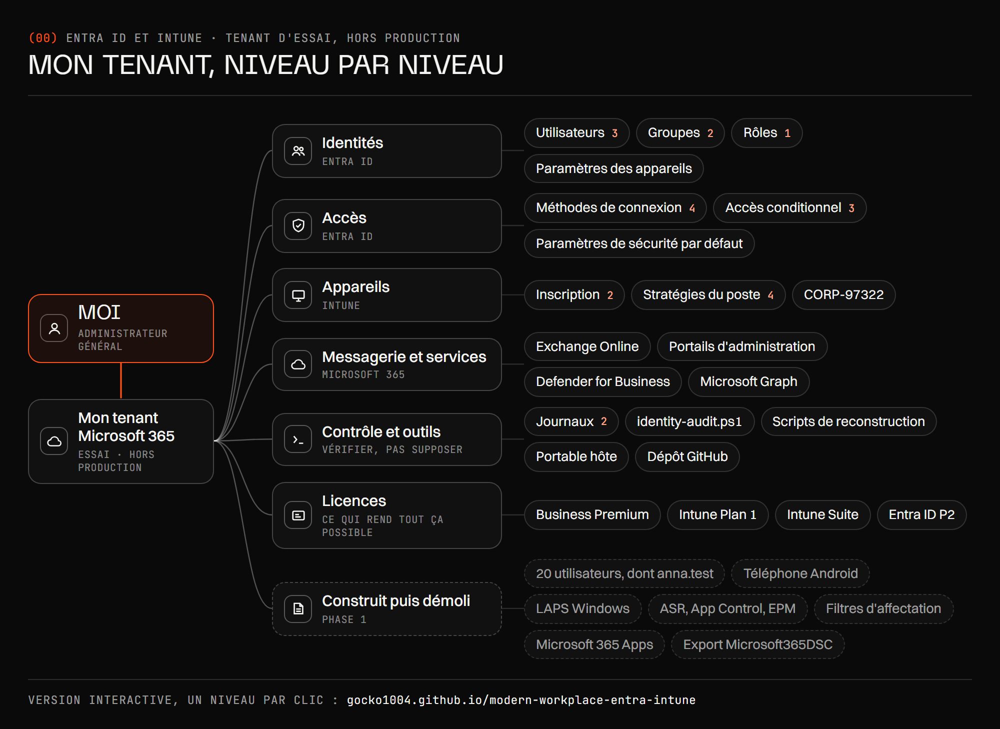

[English version](../ARCHITECTURE.md)

# Architecture

Le tenant de haut en bas : moi en administrateur général, le tenant, puis ses sept parties. Le
[schéma interactif](https://gocko1004.github.io/modern-workplace-entra-intune/?lang=fr) ouvre un niveau par
clic, jusqu'à chaque stratégie, et dit pourquoi chaque partie est construite ainsi.

Plus bas, la visite que je présente en huit étapes, avec les captures numérotées dans son ordre. Tous les
éléments et tous les liens sont aussi sur [une carte complète](../architecture/tenant-architecture-fr.png), avec
les noms utilisés sur cette page. *Utilisatrice test* sur la carte est `lea.test` dans le reste du dépôt.

## La visite, étape par étape

| Étape | Dans le schéma | Captures | Pages |
|---|---|---|---|
| 1 · Le tenant | Business Premium Intune Plan 1 Intune Suite Entra ID P2 | En direct : Centre d'administration Microsoft 365 › Facturation › Licences | [Ce que le labo couvre](README.md#ce-que-le-labo-couvre) |
| 2 · Les identités | Admin quotidien emergency-access-01 Utilisatrice test EmergencyAccess Dyn-Autopilot-Devices Administrateur général | En direct : Entra › Utilisateurs, Groupes, Rôles et administrateurs | [Identité](identity/README.md) |
| 3 · Ne jamais perdre l'accès | emergency-access-01 EmergencyAccess Clé d'accès (FIDO2) Passe d'accès temporaire Admin quotidien Microsoft Authenticator | [01](../screenshots/01-emergency-access-tap-sign-in.png) [02](../screenshots/02-emergency-access-passkey-only.png) [03](../screenshots/03-emergency-access-passkey-aaguid.png) | [Compte d'urgence](identity/README.md#1-un-compte-daccès-durgence-avant-toute-stratégie), [Clé d'accès](identity/README.md#2-une-clé-daccès-sur-un-compte-sans-méthode) |
| 4 · Les règles d'accès | CA001 · MFA pour tous CA002 · Bloquer l'authentification héritée CA003 · Appareil conforme (Windows) Paramètres de sécurité par défaut EmergencyAccess | [04](../screenshots/04-access-rules-no-policies-after-teardown.png) [05](../screenshots/05-access-rules-security-defaults-off.png) [06](../screenshots/06-access-rules-lockout-warning.png) [07](../screenshots/07-access-rules-whatif-test-user.png) [08](../screenshots/08-access-rules-whatif-emergencyaccess-excluded.png) [09](../screenshots/09-access-rules-report-only-sign-in.png) [10](../screenshots/10-access-rules-ca001-ca002-ca003-on.png) | [Accès conditionnel](identity/README.md#4-accès-conditionnel) |
| 5 · Le poste de travail | CORP-97322 Autopilot · APUserDrivenEntraJoin Inscription automatique (MDM) Dyn-Autopilot-Devices CP-Windows ES-BitLocker-OS ES-Defender-AV CFG-Edge-SmartScreen Paramètres des appareils | [11](../screenshots/11-workstation-mdm-authority-none.png) [12](../screenshots/12-workstation-dyn-autopilot-devices.png) [13](../screenshots/13-workstation-autopilot-apuserdrivenentrajoin.png) [14](../screenshots/14-workstation-corp-97322-encrypted.png) [15](../screenshots/15-workstation-cp-windows-compliant.png) [16](../screenshots/16-workstation-cfg-edge-smartscreen.png) | [La chaîne Autopilot](rebuild/README.md#la-chaîne-autopilot), [Conformité](rebuild/README.md#conformité) |
| 6 · Vérifier, pas supposer | Journaux de connexion Journaux d'audit identity-audit.ps1 Microsoft Graph | [17](../screenshots/17-checks-audit-exclusion-was-the-user.png) [18](../screenshots/18-checks-audit-exclusion-fixed.png) [19](../screenshots/19-checks-audit-emergency-sign-ins.png) [20](../screenshots/20-checks-audit-test-user-sign-ins.png) [21](../screenshots/21-checks-bitlocker-portal-access-denied.png) [22](../screenshots/22-checks-bitlocker-graph-403.png) [23](../screenshots/23-checks-bitlocker-graph-200-ok.png) [24](../screenshots/24-checks-bitlocker-three-recovery-keys.png) [25](../screenshots/25-checks-defender-pua-protection-off.png) | [Vérification avec PowerShell](identity/README.md#5-vérification-avec-powershell), [Journal du lab](LAB-LOG.md) |
| 7 · Démolir et reconstruire | 20 utilisateurs, dont anna.test Téléphone Android LAPS Windows ASR, App Control, EPM Filtres d'affectation Microsoft 365 Apps Export Microsoft365DSC Scripts de reconstruction Dépôt GitHub | [26](../screenshots/26-first-round-update-pin-24h2-deploys-25h2.png) [27](../screenshots/27-first-round-firewall-merge-conflict.png) [28](../screenshots/28-first-round-ca-whatif-report-only.png) [29](../screenshots/29-first-round-7zip-installed.png) [30](../screenshots/30-first-round-app-protection-on-devices.png) | [Démontage du 14 septembre](teardown/README.md), [Reconstruction](rebuild/README.md) |
| 8 · Ce que je ferais ensuite | Les points ouverts, bouton « Points ouverts » | En direct : les points ouverts | [Reste à faire](identity/README.md#reste-à-faire) |

Le pipeline d'octobre 2025 est hors du schéma : [31](../screenshots/31-pipeline-2025-secret-login.png) [32](../screenshots/32-pipeline-2025-secret-readable.png), raconté dans
[identity/workload-identity-2025.md](identity/workload-identity-2025.md).

## Chaque élément qui a une capture

| Zone | Nom dans le schéma | Captures |
|---|---|---|
| (01) Identités | emergency-access-01 | [01](../screenshots/01-emergency-access-tap-sign-in.png) [02](../screenshots/02-emergency-access-passkey-only.png) [03](../screenshots/03-emergency-access-passkey-aaguid.png) [08](../screenshots/08-access-rules-whatif-emergencyaccess-excluded.png) [19](../screenshots/19-checks-audit-emergency-sign-ins.png) |
| (01) Identités | Utilisatrice test | [07](../screenshots/07-access-rules-whatif-test-user.png) [09](../screenshots/09-access-rules-report-only-sign-in.png) [20](../screenshots/20-checks-audit-test-user-sign-ins.png) |
| (01) Identités | EmergencyAccess | [08](../screenshots/08-access-rules-whatif-emergencyaccess-excluded.png) [17](../screenshots/17-checks-audit-exclusion-was-the-user.png) [18](../screenshots/18-checks-audit-exclusion-fixed.png) |
| (01) Identités | Dyn-Autopilot-Devices | [12](../screenshots/12-workstation-dyn-autopilot-devices.png) |
| (02) Accès | Clé d'accès (FIDO2) | [02](../screenshots/02-emergency-access-passkey-only.png) [03](../screenshots/03-emergency-access-passkey-aaguid.png) |
| (02) Accès | Passe d'accès temporaire | [01](../screenshots/01-emergency-access-tap-sign-in.png) |
| (02) Accès | Windows Hello Entreprise | [20](../screenshots/20-checks-audit-test-user-sign-ins.png) |
| (02) Accès | CA001 · MFA pour tous `CA001-Require-MFA-All-Users` | [04](../screenshots/04-access-rules-no-policies-after-teardown.png) [06](../screenshots/06-access-rules-lockout-warning.png) [07](../screenshots/07-access-rules-whatif-test-user.png) [09](../screenshots/09-access-rules-report-only-sign-in.png) [10](../screenshots/10-access-rules-ca001-ca002-ca003-on.png) [17](../screenshots/17-checks-audit-exclusion-was-the-user.png) [18](../screenshots/18-checks-audit-exclusion-fixed.png) |
| (02) Accès | CA002 · Bloquer l'authentification héritée `CA002-Block-Legacy-Authentication` | [04](../screenshots/04-access-rules-no-policies-after-teardown.png) [09](../screenshots/09-access-rules-report-only-sign-in.png) [10](../screenshots/10-access-rules-ca001-ca002-ca003-on.png) [17](../screenshots/17-checks-audit-exclusion-was-the-user.png) [18](../screenshots/18-checks-audit-exclusion-fixed.png) |
| (02) Accès | CA003 · Appareil conforme (Windows) `CA003-Require-Compliant-Device-Windows` | [04](../screenshots/04-access-rules-no-policies-after-teardown.png) [07](../screenshots/07-access-rules-whatif-test-user.png) [09](../screenshots/09-access-rules-report-only-sign-in.png) [10](../screenshots/10-access-rules-ca001-ca002-ca003-on.png) [17](../screenshots/17-checks-audit-exclusion-was-the-user.png) [18](../screenshots/18-checks-audit-exclusion-fixed.png) [28](../screenshots/28-first-round-ca-whatif-report-only.png) |
| (02) Accès | Paramètres de sécurité par défaut | [05](../screenshots/05-access-rules-security-defaults-off.png) |
| (03) Appareils | CORP-97322 | [14](../screenshots/14-workstation-corp-97322-encrypted.png) [15](../screenshots/15-workstation-cp-windows-compliant.png) [16](../screenshots/16-workstation-cfg-edge-smartscreen.png) |
| (03) Appareils | Autopilot · APUserDrivenEntraJoin | [13](../screenshots/13-workstation-autopilot-apuserdrivenentrajoin.png) |
| (03) Appareils | Inscription automatique (MDM) | [11](../screenshots/11-workstation-mdm-authority-none.png) |
| (03) Appareils | CP-Windows | [15](../screenshots/15-workstation-cp-windows-compliant.png) |
| (03) Appareils | ES-BitLocker-OS | [14](../screenshots/14-workstation-corp-97322-encrypted.png) [21](../screenshots/21-checks-bitlocker-portal-access-denied.png) [22](../screenshots/22-checks-bitlocker-graph-403.png) [23](../screenshots/23-checks-bitlocker-graph-200-ok.png) [24](../screenshots/24-checks-bitlocker-three-recovery-keys.png) |
| (03) Appareils | ES-Defender-AV | [25](../screenshots/25-checks-defender-pua-protection-off.png) |
| (03) Appareils | CFG-Edge-SmartScreen | [16](../screenshots/16-workstation-cfg-edge-smartscreen.png) |
| (04) Services | Microsoft Graph | [22](../screenshots/22-checks-bitlocker-graph-403.png) [23](../screenshots/23-checks-bitlocker-graph-200-ok.png) |
| (06) Contrôle et outils | Journaux de connexion | [09](../screenshots/09-access-rules-report-only-sign-in.png) [19](../screenshots/19-checks-audit-emergency-sign-ins.png) [20](../screenshots/20-checks-audit-test-user-sign-ins.png) |
| (06) Contrôle et outils | identity-audit.ps1 | [17](../screenshots/17-checks-audit-exclusion-was-the-user.png) [18](../screenshots/18-checks-audit-exclusion-fixed.png) [19](../screenshots/19-checks-audit-emergency-sign-ins.png) [20](../screenshots/20-checks-audit-test-user-sign-ins.png) |
| (07) Construit en phase 1, puis démoli | Microsoft 365 Apps | [29](../screenshots/29-first-round-7zip-installed.png) [30](../screenshots/30-first-round-app-protection-on-devices.png) |

Les 32 captures sont décrites dans [screenshots/README.md](screenshots/README.md), sous les mêmes titres d'étape.
