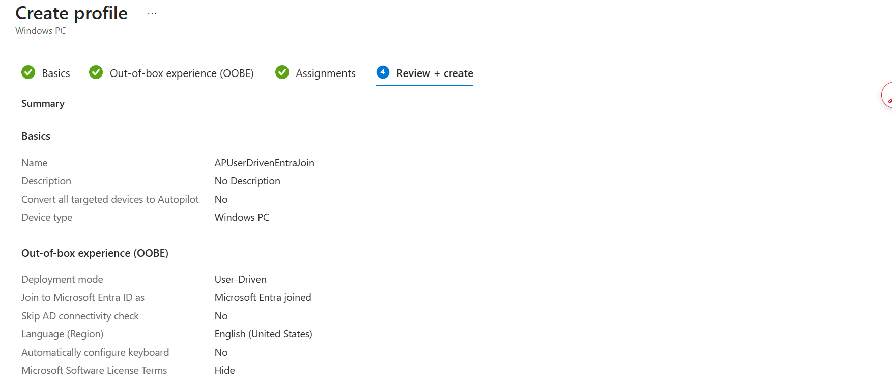
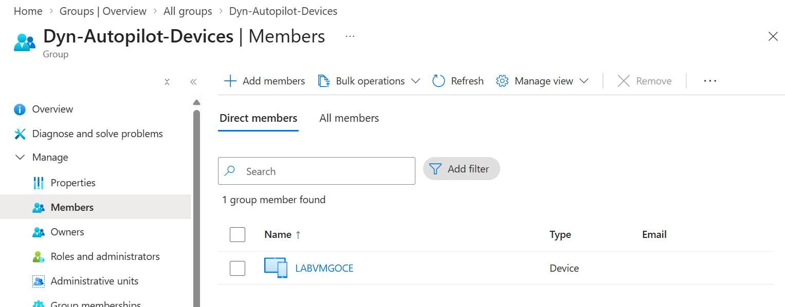

# Jour 5 : Windows Autopilot

*Enregistrer un appareil par son identité matérielle, construire le profil de déploiement, et la règle de groupe qui décide si tout cela fonctionne.*

Lundi 24 août 2026 · Parcours d'étude MD-102 · VM `LABVMGOCE`, numéro de série `<serial-redacted>`

**Ce qui existait en fin de journée**

- Hachage matériel extrait et importé, la VM est désormais un appareil Autopilot enregistré
- Profil de déploiement `APUserDrivenEntraJoin` : piloté par l'utilisateur, joint à Microsoft Entra
- Groupe dynamique `Dyn-Autopilot-Devices` construit sur la règle ZTDid, avec `LABVMGOCE` confirmé dedans
- État du profil : **Assigned**
- Page d'état d'inscription (Enrollment Status Page) configurée, avec deux paramètres délibérément modifiés avant l'enregistrement

## 1. Ce qu'est réellement Autopilot

Il vaut la peine d'être précis, parce que le nom suggère quelque chose qu'il n'est pas.

> **Pourquoi**
>
> **Autopilot n'installe pas Windows.** L'appareil a déjà Windows dessus, sorti d'usine ou issu d'une image. Autopilot prend le Windows déjà présent et, pendant l'OOBE, le transforme en appareil d'entreprise : il le joint à Entra ID, l'inscrit dans Intune, applique les stratégies, installe les applications et le remet à l'utilisateur configuré.
>
> L'ancienne méthode consistait à effacer le Windows du fabricant et à appliquer une image d'entreprise. Autopilot saute complètement cette étape. Un appareil part du fournisseur directement au domicile de l'employé, celui-ci l'ouvre, se connecte au wi-fi, ouvre une session avec son compte professionnel, et l'appareil se configure tout seul. L'IT ne touche jamais la boîte.
>
> C'est pour cela que c'est à l'examen et que c'est dans les offres d'emploi. C'est la différence entre une équipe IT qui déballe 200 portables et une qui ne le fait pas.

- **1. Enregistrer** L'identité matérielle de l'appareil est chargée dans le tenant.
- **2. Grouper** L'appareil atterrit dans un groupe dynamique via le ZTDid.
- **3. Profil** Le profil de déploiement est affecté à ce groupe.
- **4. OOBE** L'appareil se reconnaît, se joint, s'inscrit, se configure.

## 2. Extraction du hachage matériel

Autopilot identifie un appareil par un **hachage matériel** (hardware hash), une longue chaîne encodée dérivée des caractéristiques physiques de la machine : TPM, carte mère, disque, cartes réseau. C'est ainsi que le service reconnaît un appareil précis avant que cet appareil ait la moindre identité, le moindre nom ou le moindre utilisateur.

**VM, PowerShell en administrateur :**

```
Set-ExecutionPolicy -Scope Process -ExecutionPolicy RemoteSigned -Force
Install-Script -Name Get-WindowsAutopilotInfo -Force
Get-WindowsAutopilotInfo -OutputFile C:\HWID.csv
```

| Ligne | Pourquoi |
|---|---|
| `Set-ExecutionPolicy -Scope Process` | Windows bloque les scripts téléchargés par défaut. `-Scope Process` lève le blocage pour ce shell uniquement. Fermez la fenêtre et la stratégie de la machine est intacte. Ne jamais changer la stratégie d'exécution de toute la machine pour lancer un seul script. |
| `Install-Script Get-WindowsAutopilotInfo` | Le script publié par Microsoft pour lire le hachage. Il tire les valeurs de WMI et les écrit exactement dans la forme CSV attendue par l'import. |
| `-OutputFile C:\HWID.csv` | Produit le CSV à charger. |

> **La règle Microsoft : le format CSV est exact**
>
> L'import accepte un CSV avec précisément ces en-têtes :
>
> ```
> Device Serial Number,Windows Product ID,Hardware Hash
> ```
>
> Contraintes qui provoquent des rejets :
>
> - Maximum 500 lignes par fichier
> - Pas de marque d'ordre d'octets (BOM). Ouvrir le fichier dans Excel et l'enregistrer en ajoute généralement une et casse l'import
> - Les en-têtes doivent correspondre exactement, espaces compris
>
> Le fichier produit ici a été vérifié avant le chargement : 4'091 octets, 2 lignes, pas de BOM, numéro de série `<serial-redacted>`.

> **Dans la vraie vie**
>
> Vous ne lancez pas ce script sur des appareils que vous achetez. Le fournisseur les enregistre pour vous, avec les mêmes identifiants matériels, avant même que la boîte parte. Lancer le script à la main, c'est ce qu'on fait pour des appareils déjà en votre possession, ce qui est exactement la situation de migration Windows 10 vers Windows 11 que les entreprises suisses traversent en ce moment.

## 3. Import de l'appareil

**[Navigateur]** intune.microsoft.com→ Devices→ Enrollment→ Windows tab→ Devices (under Windows Autopilot)→ Import

> **Ce qui a cassé : Failed to fetch; error code 0**
>
> Le panneau d'import ne se chargeait pas. L'erreur ne donnait aucun détail utile.
>
> **Diagnostic :** une fenêtre de navigation privée a écarté les extensions du navigateur, puisque la navigation privée les désactive. Le panneau échouait toujours.
>
> **Cause :** NordVPN. Il tourne comme application de bureau, pas comme extension du navigateur, donc la navigation privée n'a aucun effet sur lui. Il interceptait les appels API du portail.
>
> **Correction :** déconnecter NordVPN.
>
> **Note :** c'était la deuxième fois dans la même semaine que NordVPN cassait quelque chose en silence dans ce lab. Quand un panneau d'un portail Microsoft ne se charge pas, sans erreur parlante, vérifiez le VPN avant toute autre chose.

L'import prend quelques minutes. L'appareil apparaît ensuite dans la liste des appareils Autopilot avec **Profile status: Not assigned**, ce qui est attendu à ce stade, puisqu'aucun profil n'existe encore.

## 4. Le profil de déploiement

**[Navigateur]** intune.microsoft.com→ Devices→ Enrollment→ Windows tab→ Deployment Profiles→ Create profile→ Windows PC

Nommé `APUserDrivenEntraJoin`.

> **Ce qui a cassé : pas de barre oblique dans le nom**
>
> Le premier nom utilisé contenait une barre oblique et a été rejeté. Les noms de profil acceptent lettres, chiffres, traits d'union et tirets bas. Renommé en `APUserDrivenEntraJoin`.

### Piloté par l'utilisateur ou autodéploiement

|  | Piloté par l'utilisateur (user-driven) | Autodéploiement (self-deploying) |
|---|---|---|
| Qui se connecte | L'utilisateur affecté, pendant l'OOBE | Personne. Aucune interaction utilisateur. |
| Résultat | Appareil joint et inscrit, utilisateur connecté et prêt | Appareil configuré et en attente sur l'écran de connexion |
| Usage typique | Portables des employés | Bornes, terminaux partagés, affichage dynamique, appareils de salle de réunion |
| Exigence | Fonctionne sur une VM | **TPM 2.0 physique obligatoire.** Ne fonctionne pas sur une VM Hyper-V. |

> **La règle Microsoft : l'autodéploiement exige un vrai TPM**
>
> Le mode autodéploiement utilise le TPM pour attester l'identité de l'appareil auprès du service, parce qu'aucun utilisateur ne se connecte pour prouver quoi que ce soit. Cette attestation exige un TPM 2.0 physique avec un certificat fabricant valide.
>
> Un TPM virtuel Hyper-V ne peut pas en fournir un, et Microsoft liste les machines virtuelles comme non prises en charge pour l'autodéploiement et le préprovisionnement. J'ai choisi le mode piloté par l'utilisateur pour cette raison, et c'est de toute façon le mode qui compte pour un scénario de portable d'employé.
>
> **Corrigé plus tard :** ce paragraphe disait d'abord que la même limite rendait Device Health Attestation impossible au Jour 4. La reconstruction a prouvé le contraire. Sur un TPM virtuel 2.0 Hyper-V, les contrôles de conformité BitLocker, Secure Boot et Code Integrity sont tous revenus Compliant, voir [reconstruction, Conformité](../rebuild/README.md#conformité). L'autodéploiement a besoin d'une attestation TPM auprès du service Autopilot, ce qui est une exigence distincte.

Paramètres utilisés :

- Deployment mode: **User-Driven**
- Join to Microsoft Entra ID as: **Microsoft Entra joined**



## 5. La règle de groupe : la partie qui décide si tout cela fonctionne

> **Ce qui a cassé : le profil restait "Not assigned"**
>
> Le profil était affecté à `Dyn-Windows-Devices`. L'appareil restait **Not assigned**.
>
> **Cause :** la règle de ce groupe est `device.deviceOSType -eq "Windows"`, qui correspond aux appareils *déjà inscrits dans Intune*. Un appareil enregistré dans Autopilot mais pas encore déployé n'est pas inscrit. Il n'existe que comme enregistrement Autopilot. Il n'a jamais correspondu.
>
> C'est un vrai problème d'ordre, pas une faute de frappe. Autopilot doit cibler l'appareil **avant** qu'il soit inscrit, donc la règle doit correspondre à quelque chose qui existe au moment de l'enregistrement. `deviceOSType` ne le fait pas.

### La bonne règle

```
(device.devicePhysicalIDs -any (_ -startsWith "[ZTDid]"))
```

> **Pourquoi ça fonctionne**
>
> **« ZTDid »**, Zero Touch Deployment ID. Quand un appareil est importé dans Autopilot, le service appose un ZTDid dans la propriété `devicePhysicalIDs` de l'objet appareil. Il est présent dès l'instant de l'enregistrement, avant toute inscription.
>
> Lecture de la règle : `devicePhysicalIDs` est une liste. `-any` signifie « au moins un élément de cette liste satisfait ce qui suit ». `_` est l'élément testé. Donc : *est-ce qu'un identifiant physique de cet appareil commence par `[ZTDid]` ?* Si oui, c'est un appareil enregistré dans Autopilot.
>
> C'est la règle documentée par Microsoft pour cet usage, reprise mot pour mot. Elle vaut la peine d'être mémorisée, elle apparaît à l'examen et dans chaque déploiement réel.

**[Navigateur]** entra.microsoft.com→ Identity→ Groups→ New group→ Type Security→ Name Dyn-Autopilot-Devices→ Membership type Dynamic Device→ Add dynamic query→ Edit (raw rule syntax)

Dans le formulaire de création du groupe, **Microsoft Entra roles can be assigned to the group** a été laissé sur **No**. Cette option concerne les groupes qui portent des attributions de rôles d'administration ; elle n'a rien à voir avec l'appartenance des appareils et la passer à Yes ajoute des restrictions dont on ne veut pas ici.

Appartenance confirmée : `LABVMGOCE` présent. Profil réaffecté à `Dyn-Autopilot-Devices`. L'état du profil est passé à **Assigned**.



## 6. La page d'état d'inscription

> **Pourquoi**
>
> L'**ESP** (Enrollment Status Page) est l'écran de progression que l'utilisateur regarde pendant un déploiement Autopilot. Sans lui, l'appareil semble rester sur un écran OOBE vide pendant vingt minutes alors que le travail se fait de façon invisible, et les utilisateurs le redémarrent, ce qui casse le déploiement.
>
> Il fait aussi quelque chose de plus important que rassurer : il peut **empêcher l'utilisateur d'atteindre le bureau tant que les applications et stratégies requises ne sont pas installées**. C'est ce qui évite qu'un utilisateur commence à travailler sur une machine à moitié configurée.

**[Navigateur]** intune.microsoft.com→ Devices→ Enrollment→ Windows tab→ Enrollment Status Page

Deux paramètres ont été délibérément modifiés avant l'enregistrement :

| Paramètre | Réglé sur | Pourquoi |
|---|---|---|
| Install Windows updates during OOBE | **No** | Le laisser activé ajoute un cycle de correctifs de 30 à 60 minutes à chaque déploiement. En production, vous pouvez le vouloir. Dans un lab, vous démontrez Autopilot, pas Windows Update, et une heure par tentative rend l'itération impossible. |
| Allow users to use device if installation error occurs | **Yes** | Réglé sur No, tout échec pendant le déploiement laisse l'appareil bloqué sur l'ESP sans autre issue qu'une reconstruction. Dans un lab, cela coûte un après-midi. C'est, de loin, la façon la plus courante de planter son premier test Autopilot. |

## 7. Ce qu'il faut retenir pour l'examen

- Autopilot configure un Windows existant pendant l'OOBE. Il n'installe pas le système d'exploitation.
- Les appareils sont identifiés par un **hachage matériel**. En production, c'est le fournisseur qui les enregistre ; vous n'extrayez les hachages à la main que pour les appareils que vous possédez déjà.
- Import CSV : exactement trois en-têtes, maximum 500 lignes, pas de BOM.
- La règle de groupe Autopilot est `(device.devicePhysicalIDs -any (_ -startsWith "[ZTDid]"))`. Les règles basées sur `deviceOSType` ne fonctionnent pas, parce que l'appareil n'est pas encore inscrit.
- Le mode **piloté par l'utilisateur** fonctionne partout. L'**autodéploiement** exige un TPM 2.0 physique et vise les bornes et les appareils partagés.
- L'ESP peut bloquer l'accès au bureau jusqu'à l'installation des applications requises. Configurez le comportement en cas d'erreur avant de lancer le moindre déploiement.
- L'état de profil "Not assigned" signifie presque toujours que la règle de groupe ne correspond pas, pas que le profil est cassé.

## 8. État des lieux avant le Jour 6

Tout est en place pour un déploiement complet de bout en bout. Avant de réinitialiser la VM jusqu'à l'OOBE et de le lancer :

> **Prendre un point de contrôle d'abord**
>
> Une VM fonctionnelle, jointe, inscrite, chiffrée, conforme a pris trois jours à construire une première fois. Un point de contrôle avant la réinitialisation fait qu'un run Autopilot raté coûte des minutes au lieu de jours.
>
> Le supprimer une fois le déploiement réussi, le Jour 4 a montré ce qu'un disque de différenciation qui traîne fait à l'espace disque et à la vitesse d'écriture.

*Jour 5 sur 5, série de labs MD-102. Rédigé à partir du journal de session, 24 août 2026. Tenant de lab uniquement, rien de tout cela n'est de la production.*
