# Identité : accès d'urgence, clés d'accès (passkeys) et accès conditionnel

17 et 18 octobre 2026. Même tenant, même machine virtuelle de labo (`CORP-97322`), même
utilisateur de test (`lea.test`).

Le jour 15 s'était terminé sur un point resté ouvert : désactiver les paramètres de sécurité par défaut pour
utiliser l'accès conditionnel avait retiré la seule exigence d'authentification multifacteur (MFA) du
tenant, et rien ne l'avait remplacée. Cette partie reprend à ce point.

---

## Le point de départ

Vérifié avant de changer quoi que ce soit, le 17 octobre.

**Stratégies d'accès conditionnel : aucune.** Le démontage avait supprimé la stratégie du jour 15 et la
reconstruction ne l'avait jamais recréée.

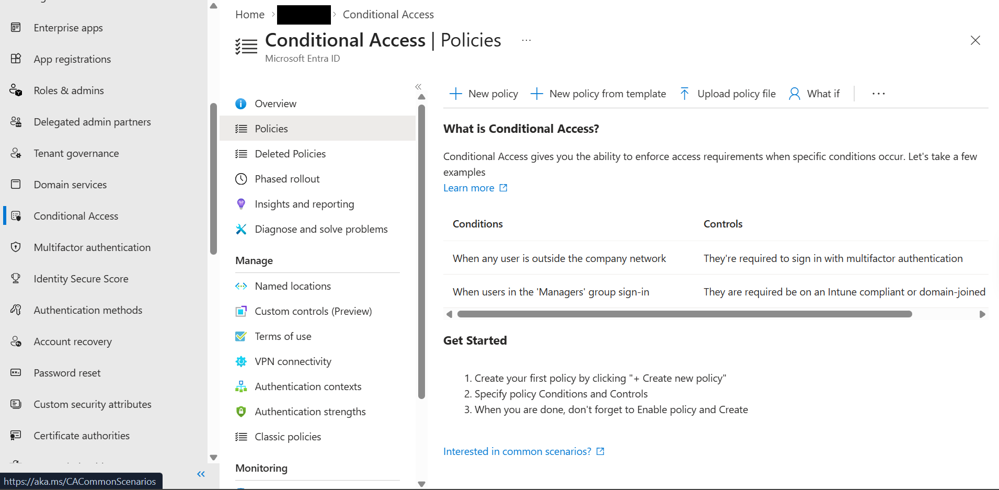

**Paramètres de sécurité par défaut : Disabled (not recommended).**

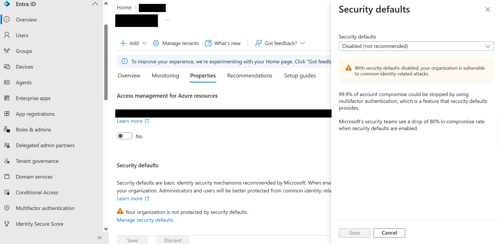

Les deux étant désactivés, rien dans la configuration propre du tenant n'exigeait l'authentification
multifacteur. La seule MFA restante était celle que Microsoft impose sur ses portails d'administration.
La faille consignée au jour 15 était restée ouverte pendant un mois, à travers le démontage et la
reconstruction.

---

## 1. Un compte d'accès d'urgence, avant toute stratégie

L'accès conditionnel peut bloquer l'accès de tous les administrateurs, donc le moyen de reprendre la main passe en premier. Les recommandations de Microsoft
([Manage emergency access accounts](https://learn.microsoft.com/en-us/entra/identity/role-based-access-control/security-emergency-access)) :
cloud uniquement sur le domaine `onmicrosoft.com`, Global Administrator en affectation permanente,
connexion résistante au hameçonnage, exclu de toute stratégie qui bloque ou restreint la connexion.

Construit :

| Élément | Valeur |
|---|---|
| Compte | `emergency-access-01@labtenant.onmicrosoft.com`, cloud uniquement |
| Rôle | Global Administrator, affecté à la création |
| Groupe | `EmergencyAccess`, groupe de sécurité, appartenance assignée, **roles can be assigned to the group: Yes** |
| Méthodes de connexion | Un mot de passe, généré et conservé hors ligne, et une clé d'accès dans Microsoft Authenticator. Aucune autre méthode |

L'option d'attribution de rôles sur le groupe était mon choix, il ne fait pas partie des consignes de Microsoft
pour ce groupe. Avec lui, seul un Global Administrator, un Privileged Role Administrator ou un
propriétaire du groupe peut changer qui en fait partie. Sans lui, un Groups Administrator ou un User
Administrator pourrait ajouter son propre compte au groupe d'exclusion et sortir de toutes les
stratégies. Il ne peut être défini qu'à la création du groupe.

Là où le labo reste en deçà des recommandations :

| Microsoft dit | Le labo | Pourquoi |
|---|---|---|
| Deux comptes ou plus | Un | Labo |
| Clé de sécurité FIDO2, rangée dans un coffre | Clé d'accès dans Authenticator sur mon propre téléphone | Pas de clé matérielle |
| Pas lié au téléphone d'une personne | Il l'est | Même raison |
| Des méthodes différentes de celles des autres comptes administrateur | En partie. Depuis le 18 octobre, le compte administrateur habituel a Microsoft Authenticator et le compte d'urgence une clé d'accès, mais les anciennes méthodes de le compte administrateur habituel sont toujours enregistrées et n'ont pas été revues | Voir section 5 |
| Méthodes résistantes au hameçonnage | Un mot de passe existe toujours | Le compte est exclu de la stratégie MFA ci-dessous, et la MFA obligatoire de Microsoft couvre les portails d'administration, pas les applications Microsoft 365 ni Microsoft Graph. Le mot de passe seul ouvrirait ceux-là. Il est conservé hors ligne ; le régler figure dans la liste plus bas |
| Un poste de travail dédié et sécurisé | Mon portable de tous les jours, dans une fenêtre privée | Labo |
| Alerte à chaque connexion du compte | Pas construite | La méthode documentée utilise Azure Monitor, qui demande un abonnement Azure |
| Tester le compte au moins tous les 90 jours | Testé le 17 octobre, utilisé pour de vrai le 18 octobre | |

---

## 2. Une clé d'accès sur un compte sans méthode

Ce que Microsoft documente, à deux endroits :

- La page des clés d'accès : un utilisateur doit avoir effectué une MFA dans les **cinq dernières
  minutes** avant d'enregistrer une clé d'accès
  ([Enable passkeys (FIDO2)](https://learn.microsoft.com/en-us/entra/identity/authentication/how-to-authentication-passkeys-fido2)).
  Un nouveau compte n'a aucune méthode pour l'effectuer.
- La page du passe d'accès temporaire (Temporary Access Pass) : un passe à usage unique compte
  comme authentification forte, et l'enregistrement doit être terminé dans les **10 minutes** qui
  suivent la connexion avec lui. Cette page lie la limite à l'application de la MFA pendant
  l'enregistrement, pas au passe lui-même
  ([Temporary Access Pass](https://learn.microsoft.com/en-us/entra/identity/authentication/howto-authentication-temporary-access-pass)).

Le passe d'accès temporaire était déjà activé pour tous les utilisateurs. J'en ai émis un pour
le compte d'urgence : usage unique, une heure.

**La première tentative n'a jamais demandé le passe.** Sur le téléphone, Android a proposé "NFC security
key, USB security key, use another device", et après annulation, la page de connexion ne proposait que "Face, fingerprint, PIN or security key" ou un mot de passe. La deuxième tentative, quelques
minutes plus tard, est passée par Authenticator : **Add work or school account**, **Sign in**, **Use
another account** dans le sélecteur de comptes du téléphone, le nom du compte, puis l'invite du passe.
Microsoft note qu'un passe fraîchement émis peut mettre un moment à apparaître. Je n'ai pas prouvé que
c'était la cause.

La connexion par le passe dans le journal :

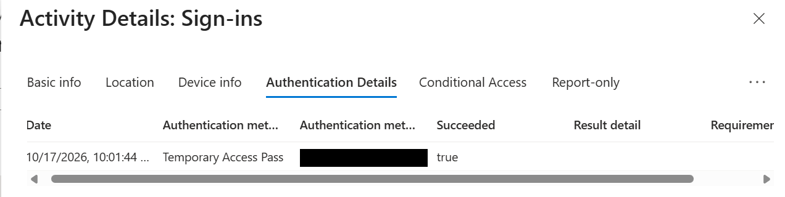

**Authenticator a enregistré plus que la clé d'accès.** La vue administrateur montrait deux méthodes
utilisables, Microsoft Authenticator (demandes push et codes à usage unique, sur un Google Pixel 7) et
la clé d'accès, avec la notification push comme méthode de connexion par défaut. Le push et les codes
peuvent être hameçonnés ; une clé d'accès, non. J'ai supprimé la méthode Authenticator et le passe
consommé. Ce qui reste :

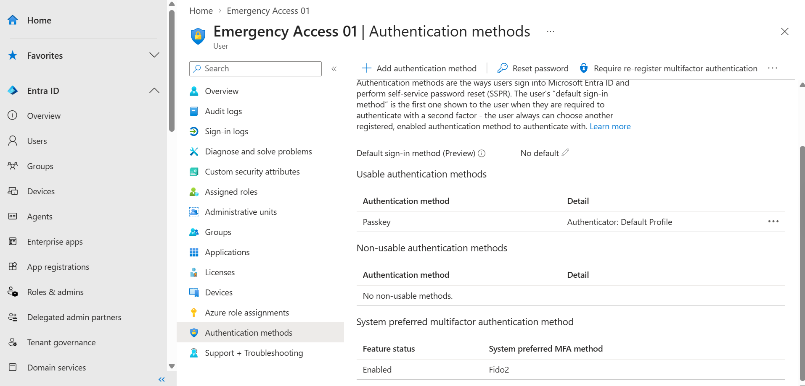

Les détails de la clé d'accès montrent l'AAGUID que signale Authenticator sur Android. Microsoft Graph
indique son niveau d'attestation comme `attested` (section 5), bien que le profil ci-dessous n'exige
pas d'attestation.

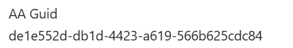

**Les paramètres de clé d'accès du tenant sont les plus permissifs qui existent.** Les profils de clé
d'accès étaient déjà activés. Le profil par défaut couvre tous les utilisateurs, attestation non
imposée, clés d'accès liées à l'appareil et synchronisées autorisées, et aucune restriction de clé. Un
profil plus strict pour le seul groupe d'urgence ne restreindrait rien : le portail indique que les
utilisateurs peuvent enregistrer une clé d'accès "if they are scoped into ANY assigned passkey
profile". Durcir le profil par défaut est une décision qui touche chaque utilisateur, donc c'est listé
plus bas, pas changé ici. Le SMS et l'appel vocal étaient déjà désactivés comme méthodes.

---

## 3. Test du compte d'urgence

Les recommandations de Microsoft sont de le tester, pas seulement de le créer. 17 octobre : fenêtre de
navigateur privée sur l'hôte, Microsoft Entra admin center, le nom du compte, puis la clé d'accès via
un code QR scanné avec le téléphone. Connecté.

L'entrée que j'ai ouverte dans le portail, Azure Portal, Success, avait un onglet Authentication Details
vide. La méthode est consignée sur l'entrée trois secondes plus tôt, que j'ai trouvée via Microsoft
Graph (section 5) : erreur **50140** avec **Passkey (device-bound)**, réussie. 50140 est l'invite
"Stay signed in?". L'étape de la clé d'accès est enregistrée sur cette entrée interrompue, pas sur le
succès qui la suit.

---

## 4. Accès conditionnel

Trois stratégies, créées en mode rapport uniquement. Chacune était censée exclure le groupe
`EmergencyAccess` ; la section 5 montre ce qu'elles excluaient réellement au départ.

| Stratégie | Utilisateurs | Ressources et conditions | Contrôle |
|---|---|---|---|
| `CA001-Require-MFA-All-Users` | All users | All resources | Require multifactor authentication |
| `CA002-Block-Legacy-Authentication` | All users | All resources, client apps: Exchange ActiveSync and other clients | Block access |
| `CA003-Require-Compliant-Device-Windows` | `lea.test` | All resources, device platform: Windows | Require device to be marked as compliant |

**Pourquoi CA003 ne couvre qu'un utilisateur.** J'administre le tenant depuis le portable hôte, qui
n'est pas inscrit dans Intune. Appliquée à tous les utilisateurs et activée, CA003 me bloquerait
l'accès aux portails d'administration. L'utilisateur de test se connecte sur `CORP-97322`, qui est
conforme. Les connexions depuis toute autre plateforme, Android, iOS, macOS, Linux ou inconnue, sont
hors du périmètre de CA003.

**L'avertissement de verrouillage.** Créer CA001 pour tous les utilisateurs fait apparaître "Don't lock
yourself out!" avec **Exclude current user** déjà sélectionné. Ce choix par défaut est la protection
de Microsoft contre le fait de se bloquer soi-même, et dans un tenant sans compte d'urgence, c'est
le choix raisonnable. Ici, le compte d'urgence est la protection, et accepter le choix par défaut
aurait laissé le compte Global Administrator habituel hors de la stratégie MFA. J'ai choisi "I understand
that my account will be impacted by this policy" à la place. J'ai supposé que le compte administrateur
habituel pouvait effectuer la MFA, parce que les portails la demandaient. La section 5 montre qu'il
ne le pouvait pas lors d'une nouvelle connexion.

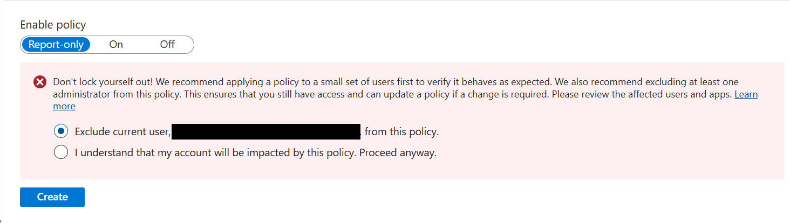

### What If, avant toute activation

Entrées : l'utilisateur de test, Office 365 Exchange Online, Windows, navigateur. Résultat : CA001 et
CA003 s'appliquent, CA002 non, parce qu'un navigateur n'est pas un client hérité.

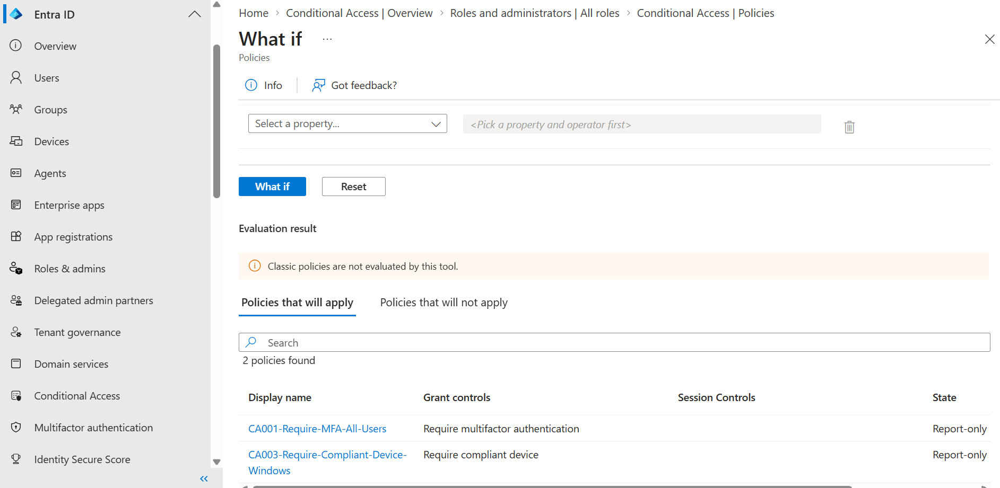

Mêmes entrées avec le compte d'urgence : aucune stratégie ne s'applique, et chacune donne la même
raison, **Users and groups**.

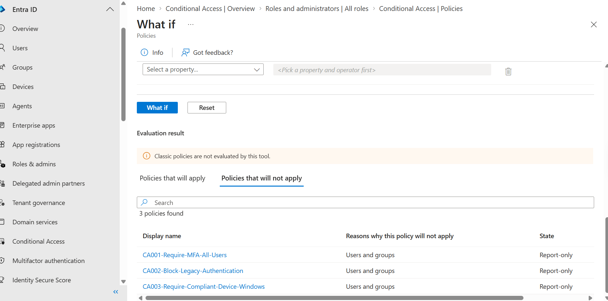

Cette raison est vraie que la stratégie exclue le compte lui-même ou un groupe dont il est membre. What
If ne peut pas distinguer les deux. La section 5 montre pourquoi cela a compté.

### Une vraie connexion, toujours en rapport uniquement

18 octobre, soir : j'ai démarré la VM, je me suis connecté comme utilisateur de test, j'ai ouvert
Outlook sur le web dans Edge.

Le journal des connexions **interactives** contenait une entrée, **Windows Sign In**, avec l'onglet
Report-only indiquant "Not applicable". Les connexions Edge de cette session étaient sur l'onglet des connexions **non interactives**. L'onglet Report-only d'une entrée Microsoft Edge :

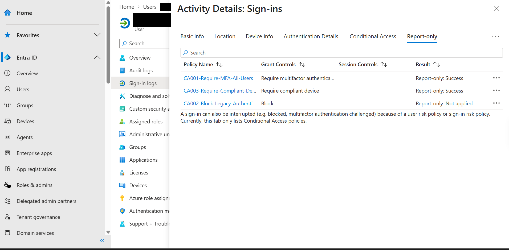

La même répartition que What If : CA001 et CA003 évaluées et satisfaites, CA002 non appliquée. CA001
était satisfaite parce que l'utilisateur de test s'était connecté à Windows avec Windows Hello for
Business, qui compte comme multifacteur : une connexion Hello donne au jeton d'actualisation principal
une revendication MFA, que les jetons d'application ultérieurs portent ensuite
([Primary Refresh Token](https://learn.microsoft.com/en-us/entra/identity/devices/concept-primary-refresh-token#when-does-a-prt-get-an-mfa-claim)).
La section 5 montre la méthode. Deux autres entrées Microsoft Edge de la même liste ont le statut
Failure ; elles sont sur la liste plus bas.

### Activées

18 octobre, après la vérification en rapport uniquement :

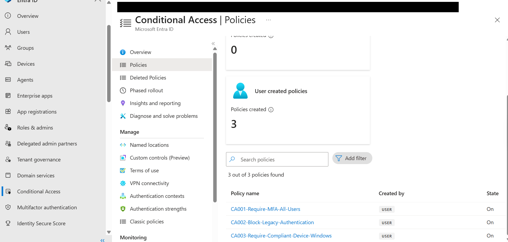

---

## 5. Vérification avec PowerShell

Le portail montre un objet à la fois. [identity-audit.ps1](../../identity/identity-audit.ps1) lit les
mêmes paramètres via Microsoft Graph en une passe et ne change rien : les stratégies d'accès
conditionnel, les méthodes, groupes et rôles du compte d'urgence, les connexions récentes avec la
méthode utilisée, et les inscriptions d'application détenant des secrets client. Il n'a besoin que du
module `Microsoft.Graph.Authentication`.

### D'abord, le compte administrateur habituel ne pouvait pas se connecter

Lancer le script demandait une nouvelle connexion avec le compte Global Administrator habituel. L'invite MFA
proposait une clé d'accès ou un code de vérification, et je n'avais ni l'un ni l'autre pour ce compte.
La session du navigateur était toujours valide. La page Microsoft du passe d'accès temporaire
dit que les rôles d'administration qui émettent des passes peuvent le faire pour d'autres
utilisateurs, "except themselves", donc le passe devait venir d'un autre compte.

Donc, le 18 octobre : connexion comme compte d'urgence avec sa clé d'accès, émission d'un passe à usage
unique pour le compte administrateur habituel, connexion avec ce passe et enregistrement de Microsoft
Authenticator. C'était la première utilisation réelle du compte d'urgence, le lendemain de sa
création.

### L'exclusion portait sur l'utilisateur, pas sur le groupe

La première exécution ne montrait aucun groupe exclu d'aucune stratégie, et le script n'avait pas de
colonne pour les utilisateurs exclus, le même angle mort que What If. Avec cette colonne ajoutée, la
deuxième exécution :

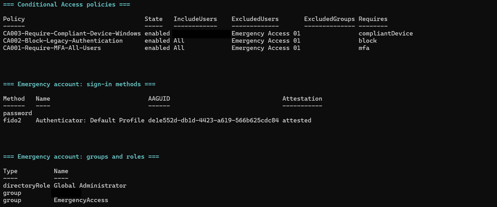

Les trois stratégies excluaient **l'utilisateur Emergency Access 01**. Aucune n'excluait le groupe
`EmergencyAccess`. Dans le sélecteur de la stratégie, l'utilisateur et le groupe ont presque le même
nom, et c'est l'utilisateur qui a été choisi. Le compte restait exclu, donc What If passait. Mais le
groupe protégé ne servait à rien : l'accès conditionnel ne le regardait jamais, et une quatrième
stratégie ne protégerait le compte que si quelqu'un pensait à l'utilisateur.

J'ai modifié les trois stratégies pour exclure le groupe. L'exécution suivante :

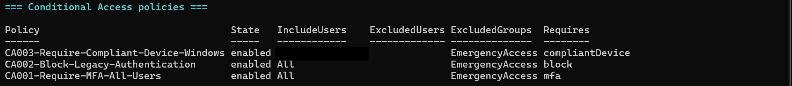

La même sortie montre le compte d'urgence détenant un mot de passe et une clé d'accès, `fido2`, avec le
niveau d'attestation `attested`, son rôle Global Administrator, et un autre groupe, caviardé parce que
son nom est celui du tenant.

### Les connexions, et quelle entrée porte la méthode

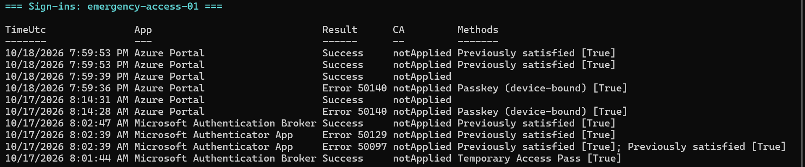

- **17 octobre, 08:01 UTC :** passe d'accès temporaire, consigné sous Microsoft Authentication
  Broker quand le compte a été ajouté à Authenticator.
- **17 octobre, 08:14 UTC :** la connexion de test. Clé d'accès sur l'entrée 50140, succès trois
  secondes plus tard sans méthode indiquée.
- **18 octobre, 19:59 UTC :** le même schéma, pour l'utilisation réelle, avec l'accès conditionnel
  **notApplied**. À ce moment-là, les stratégies excluaient encore l'utilisateur, et des trois, seule
  CA001 aurait pu s'appliquer à cette connexion. Cela montre donc que l'exclusion de l'utilisateur tient une fois les stratégies activées. L'exclusion du groupe n'a pas encore été testée par une vraie connexion.

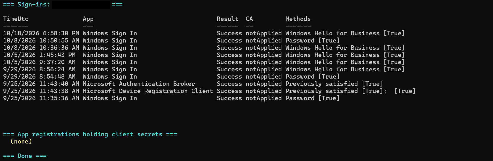

- **Utilisateur de test :** la connexion Windows du 18 octobre a utilisé **Windows Hello for Business**.
  Cela explique la revendication MFA derrière le succès de CA001 en rapport uniquement.
- **Inscriptions d'application détenant des secrets client :** aucune. La vérification lit les secrets
  client sur les inscriptions d'application seulement, pas les certificats ni les informations
  d'identification des principaux de service.

### Le script s'est arrêté en silence trois fois

Les trois premières exécutions se sont arrêtées en cours de route, sans erreur à l'écran et sans raison
donnée. Chaque vérification tourne maintenant dans son propre gestionnaire d'erreurs, affiche ce qui a
mal tourné si elle échoue, et le script se termine par un `=== Done ===` explicite. La quatrième
exécution est passée par les quatre vérifications et aucune n'a échoué. Je n'ai pas trouvé pourquoi
les exécutions précédentes s'arrêtaient.

---

## Ce que je vérifierais en premier la prochaine fois

- **L'état MFA de tout le tenant avant toute autre chose.** Les paramètres de sécurité par défaut et
  la liste des stratégies prennent une minute à lire, et ici ils montraient une faille vieille d'un
  mois.
- **Ce qu'une stratégie exclut réellement, relu après enregistrement.** Le sélecteur montre un
  utilisateur et un groupe au nom presque identique, et What If donne la même réponse pour les deux.
- **Que le compte administrateur habituel peut effectuer la MFA lors d'une nouvelle connexion** avant que
  quoi que ce soit n'en dépende.
- **L'option présélectionnée dans chaque boîte de confirmation.** Elle est juste pour le cas général,
  qui n'est pas toujours celui-ci.
- **Sur quel onglet du journal une connexion atterrit.** Les connexions Edge sur un appareil joint
  étaient non interactives et faciles à manquer.

---

## Reste à faire

- **Audits :** revue du journal d'audit, recommandations identité de Secure Score, recherche d'audit
  Purview.
- **Scénarios de support :** un administrateur qui ne peut pas effectuer la MFA (fait en partie le 18
  octobre : le passe et une nouvelle méthode ; reste à faire : retirer les anciennes méthodes et
  révoquer les sessions), diagnostiquer un utilisateur bloqué à partir du journal des connexions, un nouvel
  arrivant, un départ, l'accès à une boîte aux lettres partagée.
- **Plus de vérifications Graph :** état d'enregistrement MFA de tous les utilisateurs, membres des
  rôles d'administration.
- **Points ouverts issus de cette partie :** le mot de passe du compte d'urgence, une vraie connexion qui teste
  l'exclusion du groupe, une méthode résistante au hameçonnage pour le compte administrateur habituel, les
  deux connexions Edge en échec, pourquoi les premières exécutions du script se sont arrêtées.
- **Durcir le profil de clé d'accès par défaut**, ajouter un deuxième compte d'urgence, et une alerte
  sur son utilisation.
- **Pas dans le labo :** Active Directory local et Entra Connect. Pas de contrôleur de domaine.

Un travail d'identité plus ancien, d'octobre 2025, côté non humain : un pipeline qui se connectait avec
un secret client, et les informations d'identification fédérées mises en place pour le remplacer.
[Identité de charge de travail, octobre 2025](workload-identity-2025.md)
