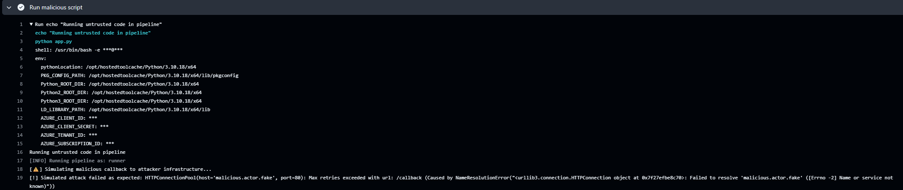

# Identité de charge de travail : un secret de pipeline, et les informations d'identification censées le remplacer

Octobre 2025, un an avant la partie identité de ce labo, dans un abonnement Azure séparé. Un pipeline
GitHub Actions déployant vers Azure, construit deux fois : une fois avec un secret stocké, une fois
configuré pour n'en utiliser aucun. Le dépôt reste privé ; la raison est à la fin.

## Le pipeline avec un secret

Le premier pipeline se connectait à Azure en tant que principal de service, l'identité d'une
inscription d'application dans Entra ID, avec un secret client enregistré comme secret GitHub. Le
journal d'exécution :

```
Attempting Azure CLI login by using service principal with secret...
...
Azure CLI login succeeds by using service principal with secret.
```


Une étape antérieure du même job exécutait du code que le pipeline ne contrôlait pas, tenant lieu de
dépendance compromise. Le workflow lui passait les identifiants comme variables d'environnement
(`env:`) :

```
AZURE_CLIENT_ID: ***
AZURE_CLIENT_SECRET: ***
AZURE_TENANT_ID: ***
AZURE_SUBSCRIPTION_ID: ***
```



GitHub affichait `***`. Le masquage cache la valeur dans le journal, pas au code qui s'exécute : le
script pouvait lire le secret et l'envoyer n'importe où. Dans l'exercice, son appel sortant partait
vers un domaine qui ne se résout pas, donc il échouait à dessein, et le journal a enregistré la
tentative.

## Le pipeline sans secret

Le second pipeline était configuré pour des informations d'identification fédérées sur l'inscription
d'application :

```json
{
  "issuer": "https://token.actions.githubusercontent.com",
  "subject": "repo:<owner>/<repo>:environment:production",
  "audiences": ["api://AzureADTokenExchange"]
}
```

À l'exécution, GitHub émet au job un jeton à courte durée de vie (`id-token: write` dans le workflow),
et Entra ID l'échange contre un jeton Azure seulement quand le sujet est exactement
`repo:<owner>/<repo>:environment:production`. Rien n'est stocké qui pourrait fuir. Tout job qui nomme
cet environnement correspond, quel que soit son déclencheur, donc les règles de protection de
l'environnement sont la vraie barrière.

**Il n'est jamais allé jusqu'à la connexion.** Six exécutions du second pipeline sont enregistrées.
Trois n'ont pas réussi à démarrer ; les trois autres se sont arrêtées au premier job, l'analyse du
code, et chaque job suivant, y compris les deux qui se connectent à Azure, a été ignoré. Les
informations d'identification fédérées sont configurées, et aucune exécution n'a jamais prouvé
qu'elles fonctionnent. C'est la première chose à corriger si ce travail est repris.

## Relu un an plus tard

- **Le fichier d'état Terraform a été commité.** L'état contient des secrets en clair : clés d'accès
  et chaînes de connexion. Le fichier d'exclusion s'appelait `gitignore`, sans le point initial, donc
  Git ne l'a jamais lu et `*.tfstate` s'est retrouvé dans le dépôt. L'état a sa place dans un backend distant, jamais dans Git.
  Les ressources Azure ont depuis été supprimées, et le dépôt reste privé parce que son historique
  contient toujours le fichier.

## La même question, côté administrateur

Un secret de pipeline, c'est un secret client sur une inscription d'application. Un tenant
peut en contenir beaucoup. La quatrième vérification de
[identity-audit.ps1](../../identity/identity-audit.ps1) liste chaque inscription d'application
détenant un secret client et le nombre de jours restants avant son expiration. Dans ce tenant de
labo, le 18 octobre 2026 : aucune. Elle lit les secrets client sur les inscriptions d'application
seulement, pas les certificats ni les informations d'identification des principaux de service.
