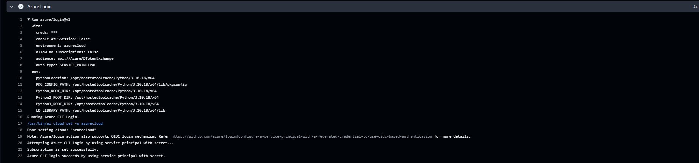

# Workload identity: a pipeline secret, and the credential meant to replace it

October 2025, a year before the identity part of this lab, in a separate Azure subscription. A
GitHub Actions pipeline deploying to Azure, built twice: once with a stored secret, once set up to
use none. The repository stays private; why is at the end.

## The pipeline with a secret

The first pipeline signed in to Azure as a service principal, an app registration's identity in
Entra ID, using a client secret saved as a GitHub secret. The run log:

```
Attempting Azure CLI login by using service principal with secret...
...
Azure CLI login succeeds by using service principal with secret.
```



An earlier step in the same job ran code the pipeline did not control, standing in for a compromised
dependency. The workflow passed it the credentials as environment variables (`env:`):

```
AZURE_CLIENT_ID: ***
AZURE_CLIENT_SECRET: ***
AZURE_TENANT_ID: ***
AZURE_SUBSCRIPTION_ID: ***
```


GitHub printed `***`. Masking hides the value from the log, not from the code that runs: the script
could read the secret and send it anywhere. In the exercise its callback went to a domain that does
not resolve, so it failed by design, and the log recorded the attempt.

## The pipeline without one

The second pipeline was set up for a federated credential on the app registration:

```json
{
  "issuer": "https://token.actions.githubusercontent.com",
  "subject": "repo:<owner>/<repo>:environment:production",
  "audiences": ["api://AzureADTokenExchange"]
}
```

At run time GitHub issues the job a short-lived token (`id-token: write` in the workflow), and Entra
ID exchanges it for an Azure token only when the subject is exactly
`repo:<owner>/<repo>:environment:production`. Nothing is stored that could leak. Any job that names
that environment matches, whatever triggered it, so the environment's protection rules are the real
gate.

**It never ran as far as the login.** Six runs of the second pipeline are recorded. Three failed to
start; the other three stopped at the first job, the code scan, and every later job, including the
two that sign in to Azure, was skipped. The federated credential is configured, and no run ever
proved it works. That is the first thing to fix if this is picked up again.

## Read again a year later

- **The Terraform state file was committed.** State holds secrets in plain text: access keys and
  connection strings. The ignore file was named `gitignore`, without the leading dot, so Git never
  read it and `*.tfstate` went in. State belongs in a remote backend, never in Git. The Azure
  resources have since been deleted, and the repository stays private because its history still
  holds the file.

## The same question, from the admin side

A pipeline secret is one client secret on one app registration. A tenant can hold many. The fourth
check in [identity-audit.ps1](identity-audit.ps1) lists every app registration holding a client
secret and the days left before each expires. In this lab tenant, on 18 October 2026: none.
It reads client secrets on app registrations only, not certificates or service principal credentials.
